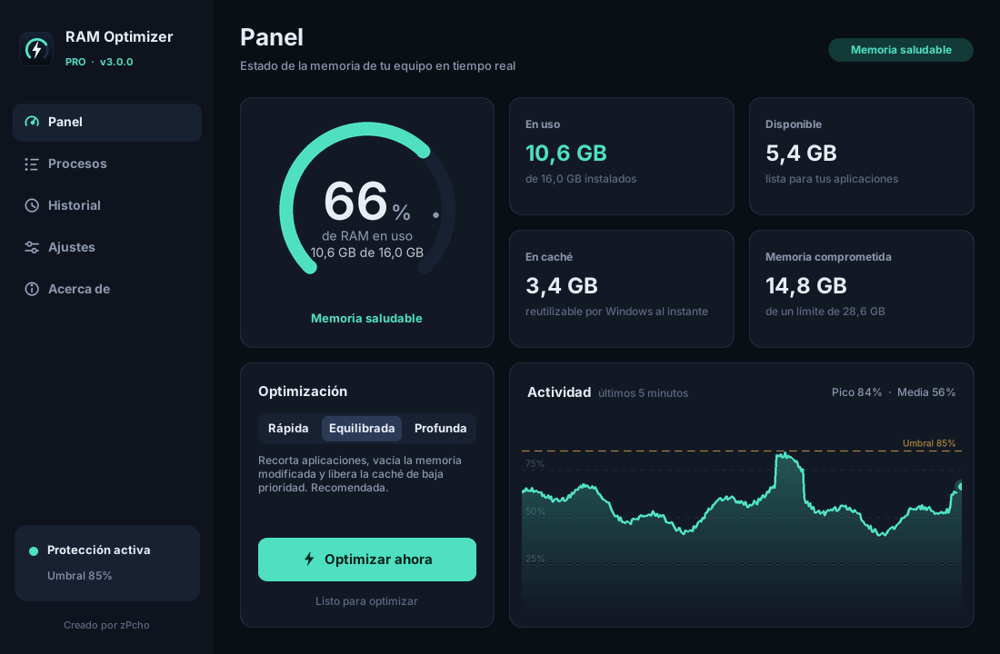
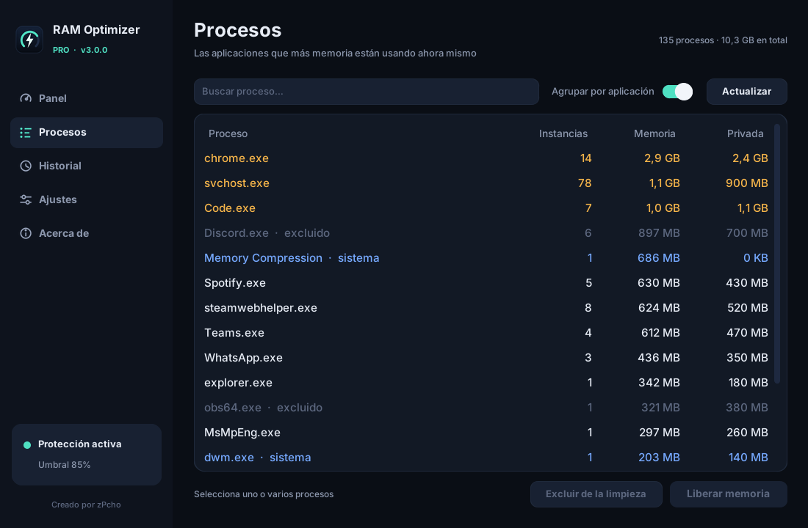

# RAM Optimizer Pro

**Libera memoria RAM automáticamente y mantén Windows rápido, sin que tengas que pensar en ello.**

### [⬇️ Descargar para Windows](https://github.com/AlejandroMayorca/RAM-Optimizer-Pro/releases/latest)

Gratis · Sin anuncios · Sin conexión a internet · En español

**Español** · [English](README.en.md)

---

## ¿Qué hace?

Con el tiempo, Windows y las aplicaciones abiertas acumulan memoria que no están usando: pestañas del navegador en segundo plano, juegos que ya cerraste, caché de archivos antiguos. **RAM Optimizer Pro** vigila tu memoria en todo momento y, cuando el uso se dispara, la libera de forma segura para que tus programas y juegos vuelvan a tener espacio.

Se instala en segundos, arranca solo con Windows y trabaja en silencio desde la bandeja del sistema.

## Características

- **Panel en tiempo real** — uso de RAM, memoria disponible, caché del sistema y una gráfica de los últimos 5 minutos.
- **Limpieza automática inteligente** — actúa solo cuando el uso supera el umbral que tú elijas de forma sostenida, y espera más entre limpiezas cuando no hacen falta.
- **Tres niveles de limpieza**
  - **Rápida:** recorta la memoria de las aplicaciones en segundo plano.
  - **Equilibrada** *(recomendada)*: además vacía la memoria modificada y la caché de baja prioridad.
  - **Profunda:** libera toda la caché del sistema y de archivos.
- **Limpieza programada** — cada 15 min, 30 min, 1 h, 2 h o 4 h.
- **Protege lo que estás usando** — nunca toca la ventana activa (tu juego, tu editor, tu videollamada) ni los procesos críticos de Windows.
- **Gestor de procesos** — mira qué consume más memoria, agrupa por aplicación, libera o excluye con un clic.
- **Inicia con Windows sin avisos** — arranca minimizado al encender el PC, sin ventanas de UAC.
- **Bandeja del sistema** — el porcentaje de RAM en vivo junto al reloj, menú rápido y notificaciones.
- **Historial** — cuánta memoria se recuperó, cuándo y cómo.
- **Tema oscuro, claro o automático.**

## Instalación

1. Descarga **`RAMOptimizerPro-Setup-3.0.0.exe`** desde [Releases](https://github.com/AlejandroMayorca/RAM-Optimizer-Pro/releases/latest).
2. Ábrelo y acepta el permiso de administrador.
3. Pulsa **Comenzar → Siguiente → Instalar**. ¡Listo!

Si ya tenías una versión anterior, el instalador la actualiza y conserva tus ajustes.

> **¿Windows muestra "Windows protegió tu PC"?**
> Es normal en programas nuevos de desarrolladores independientes que todavía no tienen firma digital de pago. Haz clic en **Más información → Ejecutar de todas formas**. Puedes comprobar el archivo con el código SHA-256 publicado en cada versión o ver su [análisis en VirusTotal](https://www.virustotal.com/gui/file/2ff0c9e875477ca8a5f9c49f3c3b087de0dda9e66504a86dc3bb6ded467ffb78).

### Requisitos

- Windows 10 u 11 de 64 bits
- 100 MB de espacio libre
- Permisos de administrador para instalar

### Desinstalar

Desde **Configuración → Aplicaciones → RAM Optimizer Pro → Desinstalar**, o desde el acceso del menú Inicio. Se eliminan el programa, los accesos directos y el inicio automático.

## Preguntas frecuentes

**¿Es seguro?**
Sí. Usa únicamente funciones oficiales de Windows (`EmptyWorkingSet`, `NtSetSystemInformation`, `SetSystemFileCacheSize`), las mismas que usan herramientas de Microsoft como RAMMap. Nunca cierra programas ni toca procesos críticos del sistema.

**¿Mis programas se cerrarán?**
No. Ningún programa se cierra. Solo se libera memoria que no se está usando en ese momento.

**¿Recopila datos?**
No. No se conecta a internet. La configuración y el historial se guardan solo en tu PC, en `%APPDATA%\RAMOptimizerPro`.

**¿Sirve para juegos?**
Sí, sobre todo en equipos con 8 GB o 16 GB de RAM. La opción *Proteger la aplicación activa* evita tocar el juego que estás jugando.

**¿Por qué pide permisos de administrador?**
Liberar la caché del sistema solo es posible con privilegios elevados. Se piden una única vez al instalar; después el programa se abre sin avisos.

## Comentarios y errores

¿Encontraste un problema o tienes una idea? [Abre un reporte aquí](https://github.com/AlejandroMayorca/RAM-Optimizer-Pro/issues/new/choose). Si te gusta el programa, deja una ⭐ al repositorio: ayuda a que más personas lo encuentren.

---

Creado por **zPcho** · © 2024-2026

